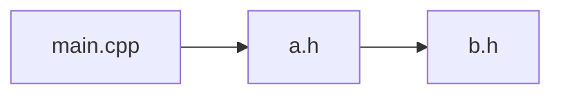

# HeaderScope

HeaderScope анализирует зависимости `#include` в проектах на C и C++. Настольное приложение на Qt для Windows и macOS показывает интерактивный граф с группировкой по папкам, находит циклы и проверяет, создаст ли новое подключение цикл. Консольная утилита `headerscope_inspect` выводит отчёты, сравнивает снимки анализа и ранжирует заголовки по числу зависимых исходников. Граф можно экспортировать в JSON или Mermaid.

## Быстрый старт

Оба варианта собирают приложение и консольную утилиту со сканером Clang LibTooling. Выполняйте команды сборки из корня клонированного репозитория. Минимальные версии зависимостей — CMake 3.21, Qt 6.5 и LLVM/Clang 18. Для сборки нужен компилятор с поддержкой C++20, для тестов — Python 3.9 или новее.

### macOS

Установите инструменты командной строки Xcode командой `xcode-select --install`, если они ещё не установлены. Для установки CMake, LLVM и Python понадобится [Homebrew](https://brew.sh/). Выберите настольный комплект macOS в [Qt Online Installer](https://doc.qt.io/qt-6/get-and-install-qt.html). В примере используется Qt 6.9.3. Если вы выбрали другую версию или каталог установки, укажите путь к своему комплекту в `QT_ROOT_DIR`.

```sh
brew install cmake llvm@18 python
QT_ROOT_DIR="$HOME/Qt/6.9.3/macos"
cmake -S . -B build-macos -G "Unix Makefiles" \
  -DCMAKE_BUILD_TYPE=Release -DHEADERSCOPE_BUILD_SCANNER=ON \
  -DCMAKE_PREFIX_PATH="$QT_ROOT_DIR;$(brew --prefix llvm@18)"
cmake --build build-macos --parallel
ctest --test-dir build-macos --output-on-failure
open build-macos/app/window/HeaderScope.app
```

Консольная утилита доступна по пути `build-macos/demo/inspect/headerscope_inspect`.

### Windows x64

Установите [MSYS2](https://www.msys2.org/) и откройте терминал **MSYS2 CLANG64**. Обновите пакеты командой `pacman -Syu`. Если MSYS2 попросит закрыть терминал, снова откройте **MSYS2 CLANG64** и повторите обновление.

```bash
pacman -S --needed mingw-w64-clang-x86_64-{clang,clang-tools-extra,llvm,lld,cmake,ninja,python,qt6-base}
cmake -S . -B build-windows -G Ninja \
  -DCMAKE_BUILD_TYPE=Release -DHEADERSCOPE_BUILD_SCANNER=ON \
  -DCMAKE_C_COMPILER=clang -DCMAKE_CXX_COMPILER=clang++ \
  -DCMAKE_PREFIX_PATH="$(cygpath -am "$MINGW_PREFIX")"
cmake --build build-windows --parallel
ctest --test-dir build-windows --output-on-failure
./build-windows/app/window/HeaderScope.exe
```

Консольная утилита доступна по пути `build-windows/demo/inspect/headerscope_inspect.exe`. Запускайте оба файла из **MSYS2 CLANG64**, чтобы были доступны библиотеки из этого окружения.

В приложении выберите `compile_commands.json` своего проекта или создайте его по инструкции для [демопроекта](#демопроект). Управление графом и проверка нового подключения описаны в [документации приложения](app/window/README.md).

Чтобы собрать только ядро графа без Qt и Clang, выполните команды ниже.

```sh
cmake -S . -B build-core -DHEADERSCOPE_BUILD_APP=OFF -DHEADERSCOPE_BUILD_SCANNER=OFF
cmake --build build-core
```

## Выпуск релиза

Готовая сборка для Mac требует macOS 15 или новее и процессор Apple Silicon.

Создайте тег версии на нужном коммите основной ветки и отправьте его на GitHub.

```sh
git tag v1.0.0
git push origin v1.0.0
```

1. Дождитесь успешного завершения **Build release packages**. Он собирает и тестирует
   приложение, затем сохраняет ZIP-архивы для macOS на Apple Silicon и Windows x64.
2. В GitHub откройте **Actions → Release → Run workflow**, укажите тег `v1.0.0`
   и запустите публикацию. В релиз попадут оба архива из сборки коммита этого тега
   и автоматически сгенерированные примечания к выпуску.

Если срок хранения архивов истёк, запустите сборку этого тега повторно:
`gh workflow run build.yml --ref v1.0.0`. Оба архива содержат Qt, библиотеки
сборщика и встроенные заголовки Clang. Приложение для macOS не нотарифицировано.

## Демопроект

Соберите небольшой проект `main.cpp → a.h → b.h`. На macOS команды ниже используют стандартный генератор CMake. На Windows выполняйте их в **MSYS2 CLANG64** и добавьте к первой команде `-G Ninja -DCMAKE_CXX_COMPILER=clang++`, чтобы CMake записал базу команд компиляции.

```sh
cmake -S demo/include-chain -B build-demo
cmake --build build-demo
```

Файл `build-demo/compile_commands.json` можно передать сборщику. Чтобы проверить условное подключение `a.h → extra.h`, повторите конфигурацию с `-DHEADERSCOPE_DEMO_EXTRA=ON`.

## Анализ в терминале

Быстрый старт уже собирает `headerscope_inspect` вместе с приложением. Для отдельной сборки CLI задайте `LLVM_PREFIX="$(brew --prefix llvm@18)"` на macOS или `LLVM_PREFIX="$(cygpath -am "$MINGW_PREFIX")"` в терминале **MSYS2 CLANG64**. На Windows добавьте к первой команде `-G Ninja -DCMAKE_C_COMPILER=clang -DCMAKE_CXX_COMPILER=clang++`.

```sh
cmake -S . -B build-inspect -DHEADERSCOPE_BUILD_APP=OFF \
  -DHEADERSCOPE_BUILD_SCANNER=ON -DCMAKE_PREFIX_PATH="$LLVM_PREFIX"
cmake --build build-inspect
build-inspect/demo/inspect/headerscope_inspect --help
build-inspect/demo/inspect/headerscope_inspect --version
build-inspect/demo/inspect/headerscope_inspect build-demo/compile_commands.json --root demo/include-chain
build-inspect/demo/inspect/headerscope_inspect build-demo/compile_commands.json --root demo/include-chain --cycles-only
```

Полный отчёт группирует прямые подключения по файлу и показывает номера строк.
Повторные подключения одного заголовка перечисляются в одной строке отчёта.
Отдельные секции показывают итог анализа, файлы без прямых подключений и циклы.
Пути выводятся относительно `--root` или текущего каталога.

Передайте путь к файлу после базы команд, чтобы добавить секцию кратчайших
цепочек от зависимых файлов. Флаг `--cycles-only` выводит циклы без списка
подключений. Вместе с `--compare` он выводит только новые или расширившиеся
циклические группы. Этот флаг используется отдельно от `--rank` и запроса
зависимостей для одного файла.

Проверки сборщика: `ctest --test-dir build-inspect --output-on-failure`.

Для сквозных тестов CLI без Qt нужен Python 3.9+.

Тестовые проекты можно создать для ручной проверки в приложении. Например,
следующие команды показывают доступные примеры и создают проект с циклами:

```sh
python3 demo/project_generator/generate.py --list
python3 demo/project_generator/generate.py tangled build-generated/tangled
```

В приложении, собранном с `HEADERSCOPE_BUILD_SCANNER=ON`, откройте каталог
`build-generated/tangled` кнопкой «Папка…» или выберите `compile_commands.json`
кнопкой «compile_commands.json…». Анализ запустится после выбора. Генератор записывает
абсолютные пути в базу команд. После переноса проекта создайте его заново
в новом расположении. Каталог назначения должен быть новым или пустым.

```sh
ctest --test-dir build-inspect -R '^inspect_e2e' --output-on-failure
```

Тест читает [`samples.json`](demo/project_generator/samples.json), вызывает
генератор и запускает `headerscope_inspect --save`. Ожидаемый граф строится из того же описания
обходом активных связей от исходников каждого таргета с учётом его макросов.
Сравнение проверяет все файлы и прямые связи с номерами строк.
Порядок записей не учитывается.

| Проект | Что проверяется |
| --- | --- |
| `diamond` | Общий заголовок, несколько исходников, повторная директива и исходник без подключений |
| `conditional` | Две команды компиляции для одного исходника с разными макросами и неактивная ветка |
| `cycles` | Цикл из трёх заголовков и самоподключение |
| `split_cycle` | Цикл возникает в объединённом графе двух таргетов, хотя каждый таргет ацикличен |
| `tangled` | Пересекающиеся циклы, условная обратная связь, отдельный цикл в другом таргете и одноимённые заголовки в разных каталогах |

Чтобы добавить пример, задайте в `samples.json` объект с уникальным именем.
В `targets` перечислите исходники каждого таргета и при необходимости
`defines` и `include_dirs`. В `includes` перечислите прямые подключения
для каждого файла. Пути задаются относительно корня проекта. Обычную связь
можно записать строкой `"dir/a.h"`. Для условной связи используйте объект с
`header` и `when`, где `true` требует наличия макроса, а `false` — его отсутствия.
Поле `via` задаёт каталог поиска для подключения через угловые скобки.

Пример автоматически попадёт в набор `inspect_e2e.graphs` при следующем
запуске CTest. При расхождении временный проект, `expected.json` и
`actual.json` остаются в каталоге сборки.

Отдельный сценарий `inspect_e2e` проверяет сравнение снимков после изменения
флагов компиляции, рейтинг заголовков и сохранность снимка при неполном анализе.

Сборщик возвращает активные подключения из команд компиляции, объединяя одинаковые директивы между исходниками. Системные заголовки исключены. Ошибки Clang передаются в `diagnostics`, а доступные связи сохраняются со статусом `partial`. Для локальной сборки встроенные заголовки берутся из комплекта LLVM, выбранного при сборке; в релизном архиве они уже включены. Связи внутри готовых PCH/модулей не восстанавливаются.

Консольная утилита показывает связи с номерами строк, все простые циклы по группам и кратчайшие цепочки от зависимых файлов до выбранного заголовка. Вкладка «Проверка #include» в приложении отвечает, замкнёт ли новое подключение цикл, и показывает причину на графе. Для проверки существующего цикла повторите конфигурацию демопроекта с `-DHEADERSCOPE_DEMO_CYCLE=ON` и запустите анализ повторно.

## Сравнение анализов и рейтинг заголовков

В `headerscope_inspect` доступны `--save snapshot.json`, `--compare snapshot.json`
и `--rank`. Их можно совмещать с выбором файла и друг с другом. Пример из корня
репозитория, после сборки `build-inspect`:

```sh
cmake -S demo/include-chain -B build-demo -DHEADERSCOPE_DEMO_EXTRA=OFF -DHEADERSCOPE_DEMO_CYCLE=OFF
build-inspect/demo/inspect/headerscope_inspect build-demo/compile_commands.json --save build-demo/before.json

cmake -S demo/include-chain -B build-demo -DHEADERSCOPE_DEMO_CYCLE=ON
build-inspect/demo/inspect/headerscope_inspect build-demo/compile_commands.json --compare build-demo/before.json --rank
```

Сравнение покажет добавленную связь `b.h:4 → a.h`, новую циклическую группу
`a.h ↔ b.h` и затронутый `main.cpp`. Перемещение директивы на другую строку и
повторы одной связи изменениями зависимостей не считаются. Для удалённых связей
учитывается и прежний граф. Выводятся все простые циклы в новых и расширившихся
циклических группах.

Рейтинг сортирует заголовки по числу зависимых исходников, затем по числу файлов,
которые подключают их напрямую. Каждый исходник считается один раз, включая
косвенные зависимости; расширения исходников: `.c`, `.cc`, `.cpp`, `.cxx`, `.c++`,
`.m`, `.mm`, без учёта регистра. Это показатель охвата изменений, а не замер
времени компиляции. Подробные цепочки можно посмотреть существующим выбором файла.

Пути в JSON-снимке относительны корню проекта: по умолчанию это текущий каталог,
можно явно задать `--root /путь/к/проекту`. При сравнении используйте тот же корень
или соответствующий корень перенесённого checkout. Сохранять и сравнивать можно
только полные анализы; ошибки сканирования не превращаются в ложные удаления.
`--compare` вместе с `--save` сначала читает прежний снимок, затем обновляет его.
Код выхода: `0` — успешный анализ, `1` — ошибка/неполный анализ, `2` — неверные аргументы.

Границы модулей, формат результата и сценарии для проверки описаны в [архитектуре и плане старта](docs/architecture.md).

## Экспорт графа

Кнопка «Экспорт графа…» сохраняет показанный результат в JSON или Mermaid (`.mmd`).
Из корня репозитория выполните одну из команд.

```sh
build-inspect/demo/inspect/headerscope_inspect build-demo/compile_commands.json --root . --export json graph.json
build-inspect/demo/inspect/headerscope_inspect build-demo/compile_commands.json --root . --export mermaid graph.mmd
```

Для демопроекта `main.cpp → a.h → b.h` экспорт Mermaid с корнем
`demo/include-chain` описывает такой граф.



Для `--export` укажите файл, отличный от `compile_commands.json`, снимка
из `--compare` и пути из `--save`. Команда экспорта сохраняет связи из частичного анализа
с отметкой `partial` и возвращает код 1. Для экспорта нужен полный или частичный
результат с путями в UTF-8.
