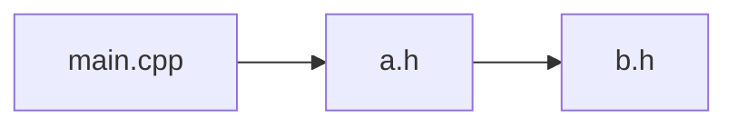

# HeaderScope

HeaderScope — приложение для macOS / Windows на C++ и Qt, которое анализирует связи `#include` в проектах на C/C++. Оно показывает, какие файлы зависят от выбранного заголовка, находит циклы и помогает проверить, создаст ли новое подключение цикл.

## Быстрый старт

Для сборки приложения нужны компилятор с C++20, CMake 3.21+ и Qt 6.5+ с модулем Qt Widgets. Для включения сборщика дополнительно нужны LLVM/Clang 18+ с библиотеками LibTooling. Команды ниже рассчитаны на запуск из корня репозитория.

```sh
cmake -S . -B build
cmake --build build
```

Если CMake не находит Qt, добавьте при конфигурации `-DCMAKE_PREFIX_PATH=/путь/к/Qt`. Укажите каталог нужного комплекта Qt для вашего компилятора и архитектуры.

На macOS запустите `open build/app/window/HeaderScope.app` при сборке генератором по умолчанию. На Windows файл `HeaderScope.exe` находится в `build/app/window/` или в его подкаталоге конфигурации, например `Debug`.

Без Qt можно собирать бэкенд и общие демоданные отдельно:

```sh
cmake -S . -B build-core -DHEADERSCOPE_BUILD_APP=OFF
cmake --build build-core
```

Главное окно позволяет выбрать проект или `compile_commands.json`, запустить анализ
в фоне, просматривать файлы, прямые подключения, зависимые файлы и диагностику.
Без Clang доступны три деморежима: цепочка подключений, цикл и частичный анализ с
ошибкой заголовка. Временное представление графа встроено в окно; точка подключения
полноценного виджета и сценарий проверки описаны в [инструкции окна](app/window/README.md).
Для реального анализа включите `HEADERSCOPE_BUILD_SCANNER=ON`. Ядро графа и сборщик
также можно проверять через консольный прототип `headerscope_inspect`.

## Демопроект

Соберите небольшой проект `main.cpp → a.h → b.h`. На macOS можно использовать стандартный генератор CMake. Если на Windows используется Visual Studio, добавьте к первой команде `-G Ninja` и запускайте её в окружении с настроенным компилятором.

```sh
cmake -S demo/include-chain -B build-demo
cmake --build build-demo
```

Файл `build-demo/compile_commands.json` можно передать сборщику. Чтобы проверить условное подключение `a.h → extra.h`, повторите конфигурацию с `-DHEADERSCOPE_DEMO_EXTRA=ON`.

## Консольный прототип анализа

Для сборщика нужны LLVM/Clang 18+ с библиотеками LibTooling. На macOS их можно установить командой `brew install llvm@18`; для поиска библиотек добавьте к конфигурации CMake `-DCMAKE_PREFIX_PATH="$(brew --prefix llvm@18)"`. Для другого комплекта LLVM можно задать `LLVM_DIR` и `Clang_DIR` — каталоги с файлами `LLVMConfig.cmake` и `ClangConfig.cmake`.

```sh
cmake -S . -B build-inspect -DHEADERSCOPE_BUILD_APP=OFF -DHEADERSCOPE_BUILD_SCANNER=ON
cmake --build build-inspect
build-inspect/demo/inspect/headerscope_inspect --help
build-inspect/demo/inspect/headerscope_inspect --version
build-inspect/demo/inspect/headerscope_inspect build-demo/compile_commands.json --root demo/include-chain
build-inspect/demo/inspect/headerscope_inspect build-demo/compile_commands.json --root demo/include-chain --cycles-only
```

Полный отчёт группирует прямые подключения по файлу и показывает номера строк.
Повторные подключения одного заголовка перечисляются в одной строке отчёта.
Отдельные секции показывают итог анализа, файлы без прямых подключений и циклы.
Пути выводятся относительно `--root` или текущего каталога.

Передайте путь к файлу после базы команд, чтобы добавить секцию кратчайших
цепочек от зависимых файлов. Флаг `--cycles-only` выводит циклы без списка
подключений. Вместе с `--compare` он выводит только новые или расширившиеся
циклические группы. Этот флаг используется отдельно от `--rank` и запроса
зависимостей для одного файла.

Проверки сборщика: `ctest --test-dir build-inspect --output-on-failure`.

Для сквозных тестов CLI без Qt нужен Python 3.9+.

Тестовые проекты можно создать для ручной проверки в приложении. Например,
следующие команды показывают доступные примеры и создают проект с циклами:

```sh
python3 demo/project_generator/generate.py --list
python3 demo/project_generator/generate.py tangled build-generated/tangled
```

В приложении, собранном с `HEADERSCOPE_BUILD_SCANNER=ON`, откройте каталог
`build-generated/tangled` кнопкой «Папка…» или выберите `compile_commands.json`
кнопкой «compile_commands.json…». Анализ запустится после выбора. Генератор записывает
абсолютные пути в базу команд. После переноса проекта создайте его заново
в новом расположении. Каталог назначения должен быть новым или пустым.

```sh
ctest --test-dir build-inspect -R '^inspect_e2e' --output-on-failure
```

Тест читает [`samples.json`](demo/project_generator/samples.json), вызывает
генератор и запускает `headerscope_inspect --save`. Ожидаемый граф строится из того же описания
обходом активных связей от исходников каждого таргета с учётом его макросов.
Сравнение проверяет все файлы и прямые связи с номерами строк.
Порядок записей не учитывается.

| Проект | Что проверяется |
| --- | --- |
| `diamond` | Общий заголовок, несколько исходников, повторная директива и исходник без подключений |
| `conditional` | Две команды компиляции для одного исходника с разными макросами и неактивная ветка |
| `cycles` | Цикл из трёх заголовков и самоподключение |
| `split_cycle` | Цикл возникает в объединённом графе двух таргетов, хотя каждый таргет ацикличен |
| `tangled` | Пересекающиеся циклы, условная обратная связь, отдельный цикл в другом таргете и одноимённые заголовки в разных каталогах |

Чтобы добавить пример, задайте в `samples.json` объект с уникальным именем.
В `targets` перечислите исходники каждого таргета и при необходимости
`defines` и `include_dirs`. В `includes` перечислите прямые подключения
для каждого файла. Пути задаются относительно корня проекта. Обычную связь
можно записать строкой `"dir/a.h"`. Для условной связи используйте объект с
`header` и `when`, где `true` требует наличия макроса, а `false` — его отсутствия.
Поле `via` задаёт каталог поиска для подключения через угловые скобки.

Пример автоматически попадёт в набор `inspect_e2e.graphs` при следующем
запуске CTest. При расхождении временный проект, `expected.json` и
`actual.json` остаются в каталоге сборки.

Отдельный сценарий `inspect_e2e` проверяет сравнение снимков после изменения
флагов компиляции, рейтинг заголовков и сохранность снимка при неполном анализе.

Сборщик возвращает активные подключения из команд компиляции, объединяя одинаковые директивы между исходниками. Системные заголовки исключены. Ошибки Clang передаются в `diagnostics`, а доступные связи сохраняются со статусом `partial`. Встроенные заголовки берутся из комплекта LLVM, выбранного при сборке; этот комплект нужен и при запуске. Связи внутри готовых PCH/модулей не восстанавливаются.

Прототип показывает связи с номерами строк, все простые циклы по группам и кратчайшие цепочки от зависимых файлов до выбранного заголовка. Вкладка «Проверка #include» отвечает, замкнёт ли новое подключение цикл, и показывает причину на графе. Для проверки настоящего цикла повторите конфигурацию демопроекта с `-DHEADERSCOPE_DEMO_CYCLE=ON` и запустите анализ повторно.

## Сравнение анализов и рейтинг заголовков

В `headerscope_inspect` доступны `--save snapshot.json`, `--compare snapshot.json`
и `--rank`. Их можно совмещать с выбором файла и друг с другом. Пример из корня
репозитория, после сборки `build-inspect`:

```sh
cmake -S demo/include-chain -B build-demo -DHEADERSCOPE_DEMO_EXTRA=OFF -DHEADERSCOPE_DEMO_CYCLE=OFF
build-inspect/demo/inspect/headerscope_inspect build-demo/compile_commands.json --save build-demo/before.json

cmake -S demo/include-chain -B build-demo -DHEADERSCOPE_DEMO_CYCLE=ON
build-inspect/demo/inspect/headerscope_inspect build-demo/compile_commands.json --compare build-demo/before.json --rank
```

Сравнение покажет добавленную связь `b.h:4 → a.h`, новую циклическую группу
`a.h ↔ b.h` и затронутый `main.cpp`. Перемещение директивы на другую строку и
повторы одной связи изменениями зависимостей не считаются. Для удалённых связей
учитывается и прежний граф. Выводятся все простые циклы в новых и расширившихся
циклических группах.

Рейтинг сортирует заголовки по числу зависимых исходников, затем по числу файлов,
которые подключают их напрямую. Каждый исходник считается один раз, включая
косвенные зависимости; расширения исходников: `.c`, `.cc`, `.cpp`, `.cxx`, `.c++`,
`.m`, `.mm`, без учёта регистра. Это показатель охвата изменений, а не замер
времени компиляции. Подробные цепочки можно посмотреть существующим выбором файла.

Пути в JSON-снимке относительны корню проекта: по умолчанию это текущий каталог,
можно явно задать `--root /путь/к/проекту`. При сравнении используйте тот же корень
или соответствующий корень перенесённого checkout. Сохранять и сравнивать можно
только полные анализы; ошибки сканирования не превращаются в ложные удаления.
`--compare` вместе с `--save` сначала читает прежний снимок, затем обновляет его.
Код выхода: `0` — успешный анализ, `1` — ошибка/неполный анализ, `2` — неверные аргументы.

Границы модулей, формат результата и сценарии для проверки описаны в [архитектуре и плане старта](docs/architecture.md).

## Экспорт графа

Кнопка «Экспорт графа…» сохраняет показанный результат в JSON или Mermaid (`.mmd`).
Из корня репозитория выполните одну из команд.

```sh
build-inspect/demo/inspect/headerscope_inspect build-demo/compile_commands.json --root . --export json graph.json
build-inspect/demo/inspect/headerscope_inspect build-demo/compile_commands.json --root . --export mermaid graph.mmd
```

Для демопроекта `main.cpp → a.h → b.h` экспорт Mermaid с корнем
`demo/include-chain` описывает такой граф.



Для `--export` укажите файл, отличный от `compile_commands.json`, снимка
из `--compare` и пути из `--save`. Команда экспорта сохраняет связи из частичного анализа
с отметкой `partial` и возвращает код 1. Для экспорта нужен полный или частичный
результат с путями в UTF-8.
